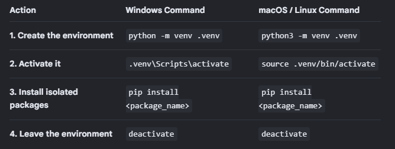

Python-
- Python is a high-level, general-purpose programming language known for its simple, English-like syntax and readability. Created by Guido van Rossum and released in 1991, it is free, open-source, and widely used across various industries.

Features-
• Easy to Read and Write: Uses clean indentation instead of complex curly brackets or semicolons, making it beginner-friendly.
• Interpreted Language: Executes code line by line, which makes testing and finding errors faster.
• Dynamically Typed: You do not need to declare data types (like integer or string) for variables ahead of time; Python figures them out while running.
• Multi-Paradigm: Supports object-oriented, functional, and procedural programming styles.
• Cross-Platform: Runs on Windows, macOS, Linux, and other operating systems

Common Uses

• Web Development: Building server-side applications and APIs (using frameworks like Django or Flask).
• Data Science and Machine Learning: Analyzing large datasets and training artificial intelligence models (using libraries like Pandas, NumPy, or TensorFlow).
• Automation and Scripting: Writing scripts to automate repetitive daily tasks, file organization, or data entry.
• Software Prototyping: Building quick applications or acting as a "glue language" to connect existing software components together

History of Python-
- Python was conceived in the late 1980s by Dutch programmer Guido van Rossum at the Centrum Wiskunde & Informatica (CWI) in the Netherlands. Van Rossum wanted to design a powerful, intuitive, high-level scripting language that fixed the flaws of its predecessor, the ABC language, while emphasizing extreme code readability and simplicity.

Milestones timeline-

Key Milestone Timeline

• December 1989 (The Conception): Van Rossum began working on Python as a "hobby" project to keep himself occupied during the Christmas holidays when his office closed.

• February 1991 (Python 0.9.0): The first public code was posted to the Usenet alt.sources group. This initial version already featured core data types (like lists, dicts, and strings), object-oriented classes, and exception handling.

• January 1994 (Python 1.0): Released with functional programming tools like map, filter, and reduce, alongside support for complex numbers.

• October 2000 (Python 2.0): Introduced crucial modern features like Unicode support, list comprehensions, and a cycle-detecting garbage collector. It also marked a shift toward a more transparent, community-backed development ecosystem.

• December 2008 (Python 3.0): A major, intentionally backwards-incompatible upgrade (often called "Python 3000" or "py3k"). It was designed to clean up design redundancies and internal inconsistencies. The transition from Python 2 to Python 3 took over a decade due to breaking changes in existing third-party libraries.

Data Science Boom- 
ans -While Python began as a tool for system utilities and web backend scripts, its trajectory changed radically in the 2010s. Due to its simple syntax and openness to community expansion, it became the foundation for massive scientific and numerical libraries like NumPy, Pandas, and Scikit-learn.
With the explosion of modern Artificial Intelligence, libraries like TensorFlow and PyTorch cemented Python as the undisputed industry standard for data science, machine learning, and neural network 

Anaconda and Python Installation-
Anaconda is a free, open-source distribution of the Python and R programming languages specifically tailored for data science, machine learning, and large-scale data processing.
Think of vanilla Python (from Python.org) as a brand-new smartphone that only has factory-default apps. Installing Anaconda is like buying that same phone, but it already comes pre-loaded with hundreds of the most popular apps you will ever need.

How to install Anaconda- 

Step 1: Download the Installer

1. Go to the Anaconda Download Page.
2. Click the Download button. The website should automatically detect your operating system. If it doesn't, select the appropriate installer from the Windows, macOS, or Linux options below the button.

Step 2: Run the Installation Process
Choose the appropriate tab below for your operating system:

For Windows

1. Locate the downloaded .exe file (usually in your Downloads folder) and double-click to run it.
2. Click Next on the welcome screen, and click I Agree after reading the License Agreement.
3. For Select Installation Type, choose Just Me (Recommended) unless you specifically need it available for all Windows user profiles. Click Next.
4. Choose the default installation path (or pick a folder with at least 5GB of free space) and click Next.
5. On the Advanced Installation Options page:
	• Keep Register Anaconda3 as my default Python checked.
	• It is usually not recommended to check "Add Anaconda3 to my PATH environment variable" unless you know you need it, as it can conflict with other Python setups. Instead, you will use the Anaconda Prompt to run commands.
6. Click Install. Once finished, click Next, then Finish.

For macOS

1. Double-click the downloaded .pkg file to launch the graphical installer.
2. Click Continue through the introduction, Read Me, and License screens, then click Agree.
3. Choose Install for me only when prompted for the destination select.
4. Click Install. You may be asked to enter your Mac's administrator password to authorize the installation.
5. Click Close once the installer finishes.

For Linux

1. Open your terminal and navigate to your downloads directory (e.g., cd ~/Downloads).
2. Run the installer script using bash followed by the filename you downloaded:bash
bash Anaconda3-XXXX.XX-Linux-x86_64.sh
Use code with caution.
3. Press Enter to review the license agreement, and type yes to accept the terms.
4. Press Enter to accept the default installation location.
5. When asked "Do you wish the installer to initialize Anaconda3 by running conda init?", type yes and hit Enter.
6. Close and reopen your terminal window to apply the changes.

Step 3: Verify the Installation

To make sure everything was set up perfectly:
1. Open your terminal (macOS/Linux) or open the Anaconda Prompt from your Start Menu (Windows).
2. Type the following command and press enter:bash
conda --version
Use code with caution.
3. If it returns the version number (e.g., conda 24.x.x), your installation was successful!

Step 4: Launching Tools

• To use the Graphical Interface: Search for and open Anaconda Navigator from your applications menu. From here, you can launch tools like Jupyter Notebook, Spyder, or VS Code with a single click.
• To launch Jupyter Notebook directly via command line: Open your terminal or Anaconda Prompt, type jupyter notebook, and press Enter.

How to Install Python- 

Step 1: Download the Official Python Installer

1. Open your web browser and go to the official Python Downloads Page.
2. Click the yellow Download Python 3.x.x button (it will automatically show the latest stable version for your operating system).
3. Save the installer file to your computer.

Step 2: Run the Installer (Crucial Step)

1. Locate the downloaded file (usually named something like python-3.x.x.exe for Windows or .pkg for Mac) in your Downloads folder and double-click it.
2. Important (Windows users): At the bottom of the installation window, check the box that says "Add python.exe to PATH".
	• Why? Checking this box allows you to run Python commands directly from your Terminal or Command Prompt. If you miss this, you will have to manually configure your environment variables later.
3. (Optional) Check the box for "Use admin privileges" if you want Python available for all profiles on your PC.
4. Click Install Now.

Step 3: Complete the Setup

1. If a system prompt asks, "Do you want to allow this app to make changes to your device?", click Yes.
2. Wait a few moments for the installation progress bar to finish.
3. Once successful, click Close.

Step 4: Verify the Installation

To make sure everything installed properly, you should check your system's command line.
1. Open your Terminal:
	• Windows: Press the Windows Key + R, type cmd, and press Enter.
	• Mac: Press Cmd + Space, type Terminal, and press Enter.
2. Type the version command:
	• On Windows, type: python --version and press Enter.
	• On Mac, type: python3 --version and press Enter.
3. Confirm: If it's installed correctly, the terminal will print out the specific version number you just installed (e.g., Python 3.13.1)

Code Editor
A Code Editor is a software application used to write, edit, and manage programming code. It provides features that make coding easier, such as syntax highlighting, auto-completion, and error detection.
Key Features:
- Syntax highlighting
- Code auto-completion
- Search and replace
- Code formatting
- Support for multiple programming languages
Examples: Visual Studio Code, Notepad++, Sublime Text.
Example: A developer can write a Python program in a code editor and save it with the .py extension

IDE
-IDE stands for Integrated Development Environment.
An IDE is a software application that combines a code editor with tools required to develop, execute, debug, and test programs.
Key Features:
- Code editor
- Code execution
- Debugging tools
- Project management
- Error detection
- Testing support
- Integration with Python interpreters and environments
Examples: PyCharm, Spyder, and Visual Studio.
Example: In PyCharm, a developer can write Python code, execute it, identify errors, debug the program, and manage project files.

Jupyter Notebook
- Definition: Jupyter Notebook is an interactive computing environment that allows users to write and execute code, display output, create visualizations, and document their work in a single notebook.
It is widely used in Data Science, Machine Learning, statistical analysis, and education.
Key Features
- Code cells: Execute Python code.
- Markdown cells: Write headings, explanations, and formatted notes.
- Inline output: Display results directly below code cells.
- Visualization: Display graphs and charts inside the notebook.
- Interactive execution: Run individual cells without executing the entire document.
- Notebook format: Files commonly use the .ipynb extension.

Pycharm
- Definition: PyCharm is an IDE designed specifically for Python development.
It is useful for developing Python applications, managing projects, debugging programs, and writing maintainable code.
Key Features
- Intelligent code completion
- Syntax highlighting
- Integrated debugger
- Project and file management
- Code navigation and refactoring
- Testing support
- Python interpreter and virtual environment configuration

Advantages
- Suitable for large Python projects.
- Helps identify and debug programming errors.
- Provides structured project management.
- Supports professional Python development workflows.
Limitations
- Has more features to learn than a basic editor.
- Can consume more system resources than lightweight editors.
- Some advanced features depend on the edition.
Best suited for: Python application development, multi-file projects, and professional software engineering.

Visual Studio Code (VS Code)
Definition: Visual Studio Code is a lightweight, extensible source-code editor that supports Python development through extensions.
Key Features
- Syntax highlighting and auto-completion
- Integrated terminal
- Debugging support
- Git and GitHub integration
- Python extension support
- Jupyter Notebook support through appropriate extensions
Advantages
- Flexible and customizable.
- Supports multiple programming languages.
- Suitable for Python scripts, Data Science, and application development.
- Provides a convenient integrated terminal.
Limitations
- Python functionality may require extensions and configuration.
- Beginners must understand interpreter selection and environment setup.
Best suited for: General Python development, Data Science workflows, and projects involving multiple technologies.

Spyder
Definition: Spyder is an IDE designed primarily for scientific computing and data analysis using Python.
It is particularly useful for students and researchers working with numerical data.
Key Features
- Code editor
- Interactive Python console
- Variable Explorer
- Debugging support
- Integration with scientific Python libraries
Advantages
- Convenient for numerical computations.
- Variable Explorer makes it easy to inspect DataFrames, arrays, and variables.
- Useful for scientific and analytical workflows.
Limitations
- Less focused on large application development than some general-purpose IDEs.
- Its interface may take time for beginners to understand.
Best suited for: Scientific computing, statistics, and data analysis.

IDLE
Definition: IDLE is a basic Python development environment distributed with many standard Python installations.
It is designed for beginners and simple Python programs.
Key Features
- Basic code editor
- Interactive Python Shell
- Syntax highlighting
- Basic debugging support

Advantages
- Simple interface.
- Useful for learning Python fundamentals.
- Usually available with a standard Python installation.
Limitations
- Limited project-management features.
- Less suitable for large-scale applications and advanced Data Science workflows.
Best suited for: Beginners learning Python syntax and writing small programs.

Canopy
Definition: Enthought Canopy was a Python environment designed primarily for scientific computing, numerical analysis, and data analysis.
Historical Features
- Scientific Python packages
- Python development tools
- Support for numerical and analytical workflows
- Environment management
Importance
Canopy is a historical tool that may appear in older Data Science syllabi. Before recommending it for a new installation, verify its current availability and support.
Best suited for: Understanding historical scientific Python environments rather than choosing a default tool for a new course.

Rodeo
Definition: Rodeo was a Python IDE designed specifically for Data Science workflows.
It aimed to provide an interactive development experience for working with Python and data.
Historical Features
- Python code editor
- Interactive execution
- Data Science-oriented workflow
- Integration with Python analysis libraries
Limitations
Rodeo is a discontinued or legacy tool and is not recommended as the primary environment for a new Data Science course.
Modern alternatives: Jupyter Notebook, JupyterLab, VS Code, and Spyder.

Python Environment
- A Python environment is a self-contained context or workspace where your Python code executes. It acts as a dedicated sandbox consisting of three core parts

1. The Python Interpreter: The specific version of the Python language engine running your code (e.g., Python 3.12 vs Python 3.13).
2. The Standard Library: The built-in tools and code syntax bundled directly with Python.
3. Installed Packages: Any external, third-party libraries you download (like pandas, requests, or Django) to add extra features to your programs.

The Two Types of Environments

1. The Global Environment

When you first download and install Python on your computer, you create your Global Environment.
• How it works: Any package you download here is available across your entire computer system.
• The Problem: If Project A needs an old version of a package (e.g., requests v1.0), and Project B needs a new version (requests v3.0), they will conflict. Upgrading it for one project will break the other.

2. Virtual Environments (venv)

To solve the global conflict problem, developers use Virtual Environments. A virtual environment is simply an isolated, standalone folder inside your specific project directory. 

